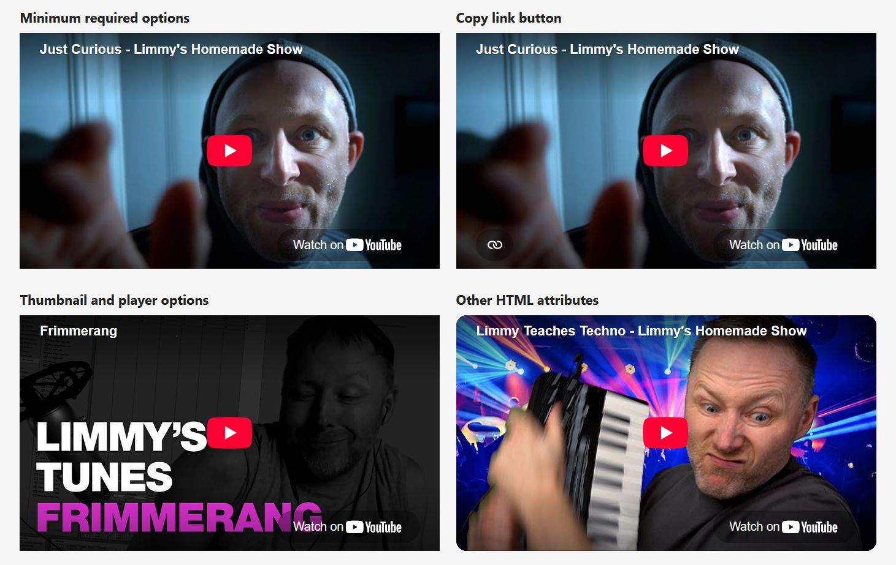

# Astro Lazy YouTube Embed

Lazily embed YouTube videos with a [static placeholder using the `<iframe>` `srcdoc` attribute](https://css-tricks.com/lazy-load-embedded-youtube-videos/), which looks like the YouTube embed (at the time of writing) but doesn't actually embed until you click.

## Install

```sh
npm i astro-lazy-youtube-embed
```

## Usage

The `title` and `videoId` params are required:

```astro
<YouTube
  title="Just Curious - Limmy's Homemade Show"
  videoId="FfTT7mxGw8I"
/>
```

### YouTube thumbnails

By default, embeds use the default YouTube thumbnail for the video at `sd` (640px) resolution.

The iframe and thumbnail use native browser lazy loading (`loading="lazy"`) by default. Pass `loading="eager"` to load the placeholder and thumbnail eagerly, for example for a video near the top of the page.

Use `thumbnailRes` to control the resolution of the YouTube thumbnail used for the placeholder - you can pass the resolution (120, 320, 480, 640, or 1280), or one of the names YouTube maps resolutions to (default, medium/mq, high/hq, standard/sd, or maxres).

> [!CAUTION]
> Not all videos will have higher resolution thumbnails available, especially older videos - check if the thumbnail is available when using higher resolutions.

Pass 1, 2, or 3 as a `thumbnail` param to use one of the 3 alternate thumbnails YouTube provides as the placeholder - these are screenshots from the video itself.

> [!NOTE]
> Some older videos will have higher resolution thumbnails available for their alternate thumbnails than for the default thumbnail.

### Custom thumbnails

To use a custom thumbnail, pass a URL as the `thumbnail` param.

### Player parameters

Use `aspectRatio` to set the player's width divided by its height, for example `aspectRatio={4 / 3}` for a 4:3 video. The default is `16 / 9`.

Pass iframe attributes such as `class`, `id`, `style` and `referrerpolicy` directly to the component. Styles accept strings or Astro style objects and extend the responsive defaults:

```astro
<YouTube
  title="The Count Censored"
  videoId="6AXPnH0C9UA"
  aspectRatio={4 / 3}
  style="max-width:640px;border:0"
/>
```

Use `embedParams` to pass [YouTube IFrame Player API parameters](https://developers.google.com/youtube/player_parameters#Parameters) for the embed, e.g. to set start & stop times to play a particular section when clicked.

Default `embedParams` are:

```js
{
  // automatically start to play when the player loads
  autoplay: 1,
}
```

### Privacy

Videos are embedded using `www.youtube-nocookie.com/embed` by default. This is YouTube's "[privacy-enhanced mode](https://support.google.com/youtube/answer/171780?hl=en#zippy=%2Cturn-on-privacy-enhanced-mode)" (🧂🤏) URL. YouTube says embedded views in this mode aren't used to personalise the viewer's YouTube browsing experience.

To embed using `www.youtube.com/embed` instead, pass a `cookie` flag:

```astro
<YouTube cookie ... />
```

### "Watch on YouTube" link

The "Watch on YouTube" link from the YouTube embed is recreated, as some users prefer not to watch embedded videos, or to use the link to [download the video](https://github.com/yt-dlp/yt-dlp#readme) instead.

If you want to omit this link (saving ~3.4 KB of HTML per video, or ~1.4 KB gzipped), pass a `noLink` param.

### Copy link button

Pass `copyLink` to emulate the YouTube embed's copy link button:

```astro
<YouTube copyLink title="Just Curious - Limmy's Homemade Show" videoId="FfTT7mxGw8I" />
```

This adds ~2 KB of HTML per video (~0.75 KB gzipped), including the icon, styles, and script. Compressed sizes depend on the rest of the page.

The copied URL includes the start time from `embedParams.start`, if provided. `copyLink` works independently of `noLink` and is ignored when `legacy` is enabled.

The copy button appears when the Clipboard API is available. Copying requires a secure context and clipboard permission.

### Legacy placeholder

The default placeholder recreates the current YouTube embed.

Pass `legacy` to use YouTube's previous embed style:

```astro
<YouTube legacy title="Just Curious - Limmy's Homemade Show" videoId="FfTT7mxGw8I" />
```

### Custom defaults

Create a local wrapper component to apply your own defaults:

```astro
---
// src/components/YouTube.astro
import {YouTube} from 'astro-lazy-youtube-embed'
import type {ComponentProps} from 'astro/types'

type Props = ComponentProps<typeof YouTube>

const {thumbnailRes = 'maxres', ...props} = Astro.props
---
<YouTube {...props} thumbnailRes={thumbnailRes} />
```

### Examples

```astro
---
import {YouTube} from 'astro-lazy-youtube-embed'
---

<h2>Minimum required options</h2>
<YouTube
  title="Just Curious - Limmy's Homemade Show"
  videoId="FfTT7mxGw8I"
/>

<h2>Copy link button</h2>
<YouTube
  copyLink
  title="Just Curious - Limmy's Homemade Show"
  videoId="FfTT7mxGw8I"
/>

<h2>Thumbnail and player options</h2>
<YouTube
  title="Frimmerang"
  videoId="xptCWoB_VCE"
  thumbnailRes="maxres"
  thumbnail="3"
  embedParams={{start: 19, end: 22}}
/>

<h2>Other HTML attributes</h2>
<YouTube
  class="rounded-2xl"
  id="techno"
  title="Limmy Teaches Techno - Limmy's Homemade Show"
  videoId="L0C5nyOVTzc"
/>
```


